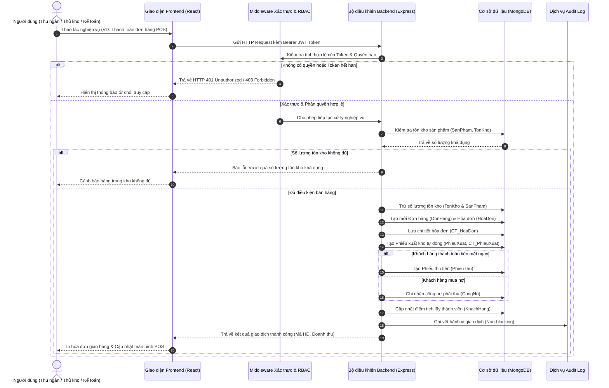
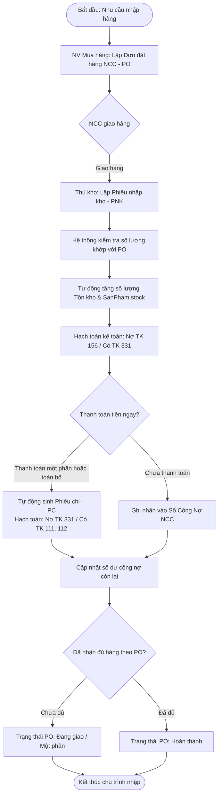
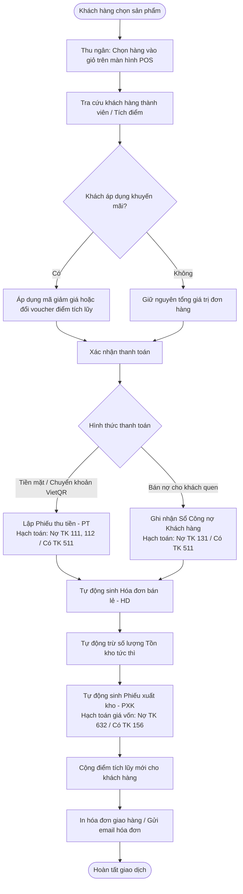
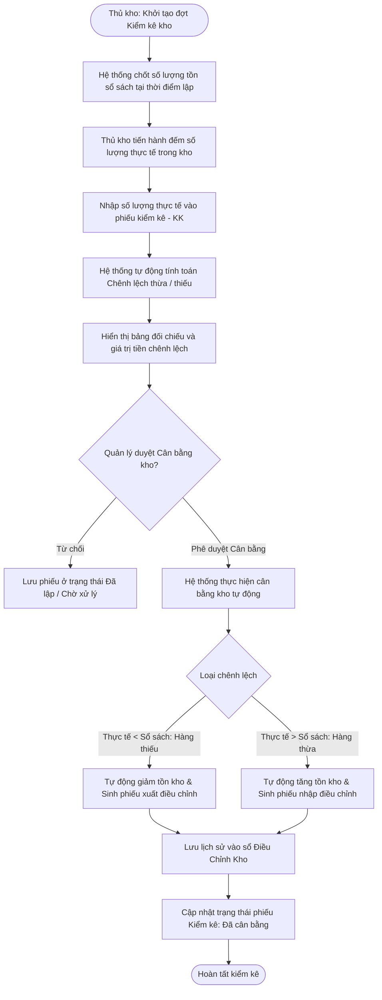
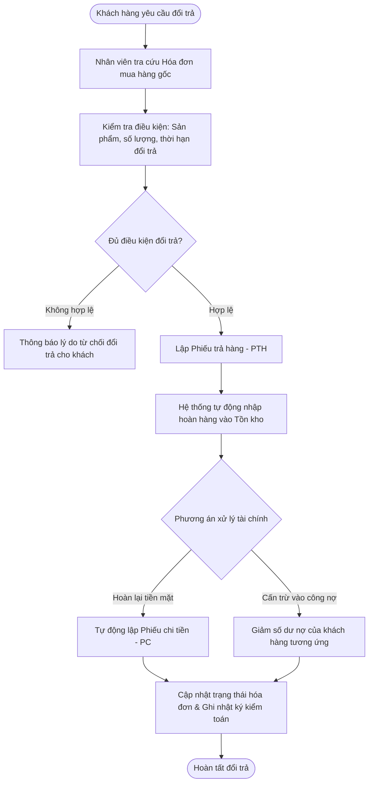
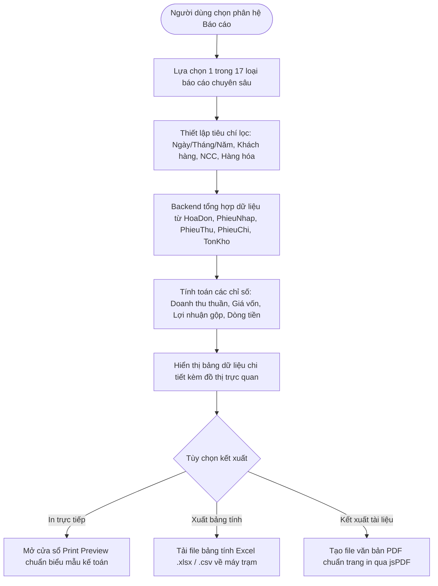

# 🍼 Hệ Thống Quản Lý Cửa Hàng Mẹ & Bé (Baby Shop Management ERP)

> **Dự án Ứng dụng Công nghệ Thông tin trong Kế toán Doanh nghiệp Thương mại**  
> Nghiên cứu và xây dựng giải pháp ERP tinh gọn, quản lý toàn diện chuỗi cung ứng, kho vận, bán lẻ POS, theo dõi công nợ hai đầu và hạch toán kế toán cho **Cửa hàng Mẹ & Bé**.

[](https://nodejs.org/)
[](https://vitejs.dev/)
[](https://react.dev/)
[](https://www.mongodb.com/)
[](https://expressjs.com/)
[](#v-kiến-trúc-hệ-thống)

---

## 📑 Mục Lục

- [I. Giới thiệu dự án](#i-giới-thiệu-dự-án)
- [II. Demo và hình ảnh giao diện](#ii-demo-và-hình-ảnh-giao-diện)
- [III. Tính năng chính](#iii-tính-năng-chính)
- [IV. Công nghệ sử dụng](#iv-công-nghệ-sử-dụng)
- [V. Kiến trúc hệ thống](#v-kiến-trúc-hệ-thống)
- [VI. Cấu trúc thư mục](#vi-cấu-trúc-thư-mục)
- [VII. Yêu cầu hệ thống](#vii-yêu-cầu-hệ-thống)
- [VIII. Hướng dẫn cài đặt và chạy dự án](#viii-hướng-dẫn-cài-đặt-và-chạy-dự-án)
- [IX. Tài khoản đăng nhập](#ix-tài-khoản-đăng-nhập)
- [X. Luồng nghiệp vụ chính](#x-luồng-nghiệp-vụ-chính)
- [XI. Báo cáo và chứng từ kế toán](#xi-báo-cáo-và-chứng-từ-kế-toán)
- [XII. Kiểm thử](#xii-kiểm-thử)
- [XIII. Bảo mật và an toàn dữ liệu](#xiii-bảo-mật-và-an-toàn-dữ-liệu)
- [XIV. Hướng phát triển](#xiv-hướng-phát-triển)
- [XV. Tác giả và đóng góp](#xv-tác-giả-và-đóng-góp)
- [XVI. Giấy phép](#xvi-giấy-phép)

---

## I. Giới thiệu dự án

### 1. Tên dự án
**HỆ THỐNG QUẢN LÝ CỬA HÀNG MẸ & BÉ (BABY SHOP MANAGEMENT ERP)**

### 2. Mô tả ngắn gọn
Hệ thống Quản lý Cửa hàng Mẹ & Bé là nền tảng phần mềm quản trị doanh nghiệp (ERP) thương mại bán lẻ chuyên sâu, được thiết kế và triển khai nhằm khép kín chu trình hoạt động của một cửa hàng kinh doanh sản phẩm mẹ và bé. Phần mềm số hóa đồng bộ từ khâu lập kế hoạch đặt hàng nhà cung cấp, nhập kho, quản lý kho hàng - hạn sử dụng, bán hàng tại quầy (POS), quản lý đổi trả, theo dõi công nợ khách hàng và nhà cung cấp, đến công tác lập phiếu thu - chi tiền tệ và tổng hợp các báo cáo tài chính - quản trị kế toán.

### 3. Mục tiêu xây dựng
- **Tự động hóa chuỗi nghiệp vụ**: Chấm dứt sự phân mảnh trong ghi chép sổ sách và các file bảng tính thủ công rời rạc; kết nối liền mạch dòng hàng hóa vật chất với dòng luân chuyển tiền tệ.
- **Hỗ trợ kế toán thương mại**: Tự động hạch toán định khoản kế toán kép (Nợ/Có theo tài khoản kế toán 111, 112, 131, 156, 331, 511, 632...), sinh chứng từ theo mẫu biểu quy định và tính toán giá trị sổ sách theo thời gian thực.
- **Chính xác hóa tồn kho**: Kiểm soát chặt chẽ biến động xuất - nhập - tồn, hỗ trợ kiểm kê định kỳ và cơ chế tự động cân bằng kho khi có chênh lệch thừa/thiếu.
- **Kiểm soát rủi ro công nợ**: Theo dõi công nợ chi tiết theo từng đối tác, hóa đơn và kỳ hạn nợ; hạn chế tối đa rủi ro nợ xấu và chiếm dụng vốn.

### 4. Bài toán thực tế mà hệ thống giải quyết
Kinh doanh mặt hàng mẹ và bé mang nhiều đặc thù khắt khe so với bán lẻ tiêu dùng thông thường:
1. **Quản lý hạn sử dụng (HSD) và hạn dùng nghiêm ngặt**: Sữa bột công thức, thực phẩm ăn dặm, mỹ phẩm cho bé có HSD ngắn; nếu không kiểm soát tốt sẽ gây hư hỏng và rủi ro lớn. Hệ thống cung cấp cảnh báo cận date và định mức tồn kho tối thiểu.
2. **Sai lệch giữa sổ sách và kho thực tế**: Tỷ lệ thất thoát hàng hóa kích thước nhỏ (ti giả, phụ kiện, khăn ướt) cao. Quy trình kiểm kê và cân bằng kho tự động giúp xác định chính xác nguyên nhân và giá trị thất thoát.
3. **Quản lý công nợ hai chiều phức tạp**: Cửa hàng vừa nhập nợ từ các nhà phân phối lớn (Pigeon, Mamamy, Merries...) vừa bán nợ/trả góp cho khách hàng quen. Hệ thống tự động gạch nợ từng phần hoặc toàn phần và cập nhật số dư tức thì.
4. **Áp lực thanh toán tại quầy (POS)**: Giờ cao điểm đòi hỏi nhân viên bán hàng thao tác nhanh chóng, hỗ trợ nhiều phương thức thanh toán (tiền mặt, quét mã VietQR), tự động tích điểm thành viên và xuất hóa đơn giao nhận chuẩn xác.
5. **Chậm trễ trong kết xuất báo cáo cuối kỳ**: Chủ cửa hàng và kế toán mất nhiều ngày đối soát sổ quỹ và tính toán lãi lỗ. Hệ thống cung cấp Dashboard và 17 báo cáo tài chính - quản trị kết xuất ngay lập tức.

### 5. Đối tượng sử dụng
Hệ thống phân quyền theo mô hình RBAC (Role-Based Access Control) cho 5 nhóm đối tượng chuyên trách:
- **Quản lý cửa hàng (QuanLy / QuanTriHeThong)**: Giám sát toàn bộ hoạt động kinh doanh, xem các báo cáo tổng hợp, quản lý tài khoản nhân viên, cấu hình phân quyền ma trận, tra cứu nhật ký kiểm toán và thực hiện sao lưu/phục hồi hệ thống.
- **Nhân viên bán hàng (NhanVienBanHang)**: Vận hành màn hình bán hàng POS, lập đơn hàng bán lẻ, in hóa đơn, đổi điểm thưởng voucher cho khách hàng, lập phiếu thu tiền mặt và tiếp nhận hàng đổi trả.
- **Thủ kho / Nhân viên kho (NhanVienKho)**: Tiếp nhận hàng nhập, tạo phiếu nhập kho đối chiếu với đơn đặt hàng PO, xuất kho bán lẻ, theo dõi thẻ kho và thực hiện kiểm kê kho định kỳ.
- **Kế toán viên (KeToan)**: Quản lý hóa đơn chứng từ, lập và duyệt phiếu thu - chi tiền mặt/ngân hàng, theo dõi chi tiết công nợ phải thu/phải trả, lập sổ quỹ, sổ nhật ký chung và báo cáo kết quả kinh doanh.
- **Nhân viên mua hàng (NhanVienMuaHang)**: Quản lý thông tin nhà cung cấp, theo dõi giá nhập, lập và theo dõi tiến độ các đơn đặt hàng mua (PO).

### 6. Phạm vi nghiệp vụ
Hệ thống bao gồm 7 phân hệ nghiệp vụ chính:
1. Phân hệ Quản trị hệ thống & Phân quyền bảo mật (Admin, Users, Roles, Audit Logs, Backup).
2. Phân hệ Quản lý danh mục đối tác & hàng hóa (Customers, Suppliers, Products, Categories, Employees).
3. Phân hệ Quản lý mua hàng & Nhập kho (Purchase Orders, Goods Receipts).
4. Phân hệ Quản lý bán hàng POS & Hóa đơn (Sales Orders, Invoices, Promotions, Customer Loyalty).
5. Phân hệ Quản lý kho hàng & Kiểm kê (Goods Issues, Inventory, Stocktake & Adjustments, Returns).
6. Phân hệ Quản lý thu chi tiền tệ & Công nợ (Cash Receipts, Cash Payments, Debts Management).
7. Phân hệ Báo cáo kế toán & Quản trị kinh doanh (17 báo cáo chuyên sâu, In ấn & Xuất Excel/PDF).

---

## II. Demo và hình ảnh giao diện

### 1. Hình ảnh thực tế trong repository

#### Logo nhận diện thương hiệu Cửa hàng Mẹ & Bé
Vị trí file: `frontend/public/logo.png` (và `frontend/src/assets/logo.png`):

<p align="center">
  
</p>

#### Sơ đồ luồng nghiệp vụ chuẩn của hệ thống
Vị trí file: `so_do_nguyen_goc_chuan_100.png` (phiên bản vector: `so_do_nguyen_goc_chuan_100.svg`):

<p align="center">
  
</p>

#### Sơ đồ cấu trúc dữ liệu MongoDB Logic
Vị trí file: `database/so_do_mongo_logic.png`:

<p align="center">
  
</p>

---

### 2. Danh sách gợi ý ảnh chụp màn hình cần bổ sung

Dưới đây là danh sách các màn hình chính đã hoàn thiện trong code mà nhóm phát triển có thể chụp và bổ sung vào thư mục `docs/screenshots/`:

| STT | Màn hình giao diện | File đề xuất | Mô tả nội dung cần chụp | Trạng thái mã nguồn |
| :---: | :--- | :--- | :--- | :---: |
| 1 | Màn hình Đăng nhập | `docs/screenshots/01_login.png` | Form đăng nhập kèm lựa chọn tài khoản demo nhanh | Đã hoàn thiện (`LoginPage.jsx`) |
| 2 | Bảng điều khiển (Dashboard) | `docs/screenshots/02_dashboard.png` | Thống kê KPI, biểu đồ doanh thu theo tuần, cảnh báo tồn kho thấp | Đã hoàn thiện (`DashboardPage.jsx`) |
| 3 | Màn hình Bán hàng (POS) | `docs/screenshots/03_sales_pos.png` | Giỏ hàng, tìm kiếm sản phẩm, áp voucher, chọn thanh toán VietQR | Đã hoàn thiện (`SalesPOSPage.jsx`) |
| 4 | Danh mục sản phẩm & tồn kho | `docs/screenshots/04_products.png` | Danh sách sản phẩm kèm hình ảnh, giá nhập/bán, hạn dùng | Đã hoàn thiện (`ProductsPage.jsx`) |
| 5 | Quản lý Đơn đặt hàng NCC | `docs/screenshots/05_purchase_orders.png` | Danh sách đơn đặt mua PO, trạng thái nhận hàng từng phần | Đã hoàn thiện (`PurchaseOrderPage.jsx`) |
| 6 | Phiếu nhập kho & Phiếu xuất | `docs/screenshots/06_warehouse_docs.png` | Bảng kê phiếu nhập/xuất kho, chi tiết sản phẩm và tài khoản đối ứng | Đã hoàn thiện (`WarehouseDocumentsPage.jsx`) |
| 7 | Quản lý Kiểm kê & Cân bằng | `docs/screenshots/07_stocktake.png` | Bảng đối chiếu số liệu sổ sách vs thực tế, nút Cân bằng kho | Đã hoàn thiện (`StocktakePage.jsx`) |
| 8 | Quản lý Thu - Chi tiền mặt | `docs/screenshots/08_cash_vouchers.png` | Danh sách Phiếu thu (01-TT) và Phiếu chi (02-TT) kèm số tiền bằng chữ | Đã hoàn thiện (`CashVouchersPage.jsx`) |
| 9 | Quản lý Công nợ NCC & KH | `docs/screenshots/09_debts.png` | Bảng theo dõi số dư nợ, hạn nợ và modal gạch nợ từng phần | Đã hoàn thiện (`DebtsPage.jsx`) |
| 10 | Báo cáo tài chính & Quản trị | `docs/screenshots/10_reports.png` | 17 danh mục báo cáo, bộ lọc ngày/tháng/năm và xuất file Excel/PDF | Đã hoàn thiện (`ReportPage.jsx`) |
| 11 | Xem trước mẫu in chứng từ | `docs/screenshots/11_print_preview.png` | Modal xem trước mẫu in phiếu thu/chi/hóa đơn bán lẻ có logo | Đã hoàn thiện (`DocumentPrintPreviewModal.jsx`) |
| 12 | Phân quyền vai trò (RBAC) | `docs/screenshots/12_admin_roles.png` | Ma trận quyền 24 module x 4 hành động (xem, tạo, sửa, xóa) | Đã hoàn thiện (`AdminPage.jsx`) |
| 13 | Nhật ký kiểm toán (Audit Logs) | `docs/screenshots/13_audit_logs.png` | Lịch sử thao tác người dùng, địa chỉ IP, hành động chi tiết | Đã hoàn thiện (`AuditLogPage.jsx`) |
| 14 | Sao lưu và Phục hồi | `docs/screenshots/14_backup.png` | Tạo snapshot dữ liệu JSON, tải xuống và khôi phục an toàn | Đã hoàn thiện (`BackupPage.jsx`) |

---

## III. Tính năng chính

### 1. Bảng điều khiển (Dashboard) & Thống kê thông minh
- **Số liệu tài chính tổng quan**: Doanh thu, số lượng đơn hàng, tổng công nợ phải thu/phải trả, tổng giá trị tồn kho.
- **Hệ thống biểu đồ trực quan**: Biểu đồ cột (BarChart) theo dõi doanh thu theo thời gian; biểu đồ đường (LineChart) xu hướng tăng trưởng; biểu đồ tròn (DonutChart) cơ cấu hàng hóa và trạng thái thanh toán.
- **Bộ lọc linh hoạt**: Hôm nay, 7 ngày qua, Tháng này, Năm nay và Tùy chỉnh khoảng thời gian.
- **Cảnh báo tức thời**: Danh sách sản phẩm tồn kho chạm ngưỡng tối thiểu (`LOW_STOCK_THRESHOLD`), danh sách sản phẩm cận hạn sử dụng.

### 2. Quản lý sản phẩm & Danh mục loại hàng
- **Hồ sơ sản phẩm chi tiết**: Mã sản phẩm (sinh tự động `SPxxx`), tên hàng, đơn vị tính, danh mục loại hàng, giá nhập, giá niêm yết bán lẻ, hạn sử dụng, trạng thái kinh doanh (Đang bán / Tạm ngừng).
- **Hình ảnh trực quan**: Lưu trữ liên kết ảnh sản phẩm, tự động bổ sung ảnh đại diện theo từng nhóm ngành hàng (sữa, bỉm, quần áo sơ sinh, đồ chơi).
- **Danh mục phân cấp**: Quản lý loại hàng mẹ và bé chuẩn mực, phục vụ phân nhóm và thống kê doanh thu theo ngành hàng.

### 3. Quản lý khách hàng & Chương trình thành viên tích điểm
- **Hồ sơ khách hàng**: Mã khách hàng (`KHxxx`), họ tên, số điện thoại, email, địa chỉ.
- **Tích điểm tự động**: Tích lũy điểm thưởng theo tỷ lệ doanh số mua hàng trên mỗi hóa đơn thanh toán thành công.
- **Chính sách Voucher thành viên theo hạng**:
  - Hạng Bạc (100 điểm): Đổi voucher giảm giá 50.000 VNĐ (`BAC50K`).
  - Hạng Vàng (500 điểm): Đổi voucher giảm giá 100.000 VNĐ (`VANG100K`).
  - Hạng Kim Cương (1000 điểm): Đổi voucher VIP giảm giá 200.000 VNĐ (`KC200K`).

### 4. Quản lý nhà cung cấp
- **Thông tin đối tác**: Mã nhà cung cấp (`NCCxxx`), tên đơn vị, số điện thoại liên hệ, email, địa chỉ văn phòng/kho.
- **Theo dõi lịch sử giao dịch**: Danh sách các đơn đặt hàng đã ký kết, các phiếu nhập kho đã thực hiện và tổng giá trị mua hàng lũy kế.
- **Quản lý trạng thái hoạt động**: Khóa đối tác khi ngưng hợp tác để ngăn tạo mới đơn mua và phiếu nhập kho.

### 5. Quản lý đơn đặt hàng NCC (PO) & Nhập kho hàng hóa
- **Lập đơn đặt hàng (Purchase Orders - PO)**: Chọn nhà cung cấp, lên danh sách sản phẩm, số lượng đặt, đơn giá nhập dự kiến; sinh mã tuần tự `DDHxxx`.
- **Nhập kho từng phần (Partial Receiving)**: Hỗ trợ nhận hàng theo từng chuyến; hệ thống tự động kiểm soát số lượng nhập không vượt quá số còn thiếu của đơn đặt hàng.
- **Khép kín dòng tiền & kho hàng**: Khi xác nhận phiếu nhập (`PhieuNhap`), hệ thống tự động:
  - Tăng số lượng tồn kho trong `TonKho` và `SanPham.stock`.
  - Hạch toán cặp tài khoản kế toán Nợ 156 / Có 331 (hoặc Có 111/112).
  - Tự động ghi nhận số dư công nợ nhà cung cấp nếu chưa thanh toán đủ.
  - Tự động sinh Phiếu chi (`PhieuChi`) nếu thủ kho/kế toán xác nhận trả tiền ngay.

### 6. Bán hàng tại quầy (POS) & Quản lý hóa đơn
- **Giao diện POS tối ưu**: Tìm kiếm nhanh sản phẩm theo mã hoặc tên, hiển thị tồn kho khả dụng tức thời, thao tác chọn giỏ hàng mượt mà.
- **Áp dụng khuyến mãi & Voucher**: Áp dụng mã giảm giá phần trăm toàn đơn hoặc voucher tích điểm của khách hàng.
- **Đa dạng hình thức thanh toán**: Tiền mặt hoặc Chuyển khoản qua ngân hàng (tích hợp tạo mã QR động VietQR).
- **Quy trình bán hàng tự động**:
  - Sinh mã đơn hàng (`DHxxx`) và hóa đơn (`HDxxx`).
  - Tự động trừ tồn kho tức thời để chống bán âm.
  - Tự động sinh phiếu xuất kho (`PhieuXuat`) kèm hạch toán giá vốn Nợ 632 / Có 156.
  - Tự động sinh phiếu thu tiền mặt (`PhieuThu`) hoặc ghi nhận công nợ khách hàng nếu nợ tiền.
  - Tự động cộng điểm tích lũy vào tài khoản khách hàng thành viên.

### 7. Quản lý xuất kho, Tồn kho & Kiểm kê định kỳ
- **Quản lý chứng từ xuất kho**: Xuất bán lẻ, xuất trả nhà cung cấp, xuất hủy hàng hỏng cận date.
- **Kiểm kê kho thực tế**: Lập biên bản kiểm kê (`KiemKe`), nhập số đếm vật lý, hệ thống tự động đối chiếu số liệu sổ sách, tính chênh lệch thừa/thiếu và giá trị tiền chênh lệch.
- **Cân bằng kho tự động (Adjust Stock)**: Nút thao tác một chạm tự động cân bằng số tồn hệ thống khớp chính xác với kết quả kiểm kê thực tế, tự động sinh phiếu xuất hủy (nếu thiếu) hoặc phiếu nhập bù (nếu thừa), lưu vết vào sổ `DieuChinhKho`.
- **Điều chỉnh tồn kho thủ công**: Cho phép quản lý/thủ kho điều chỉnh tồn kho khi có lý do chính đáng kèm bắt buộc ghi chú lý do.

### 8. Quản lý đổi trả hàng (Returns)
- **Lập phiếu đổi trả**: Tham chiếu trực tiếp đến mã hóa đơn mua hàng trước đó, chọn sản phẩm và số lượng trả lại kèm lý do (lỗi sản xuất, khách đổi size).
- **Xử lý hoàn kho và hoàn tiền**: Hệ thống tự động hoàn số lượng hàng về kho, tính số tiền hoàn lại cho khách, tự động cấn trừ công nợ hoặc sinh phiếu chi hoàn tiền.

### 9. Quản lý công nợ hai chiều (Debts Management)
- **Công nợ phải trả Nhà cung cấp**: Theo dõi chi tiết từng lần nhập hàng chưa thanh toán, ngày đến hạn thanh toán, số tiền đã trả và số dư nợ còn lại.
- **Công nợ phải thu Khách hàng**: Quản lý các đơn hàng bán chịu, theo dõi tuổi nợ.
- **Thanh toán công nợ linh hoạt**: Hỗ trợ gạch nợ từng phần hoặc thanh toán tất toán toàn bộ; tự động sinh chứng từ kế toán tương ứng (Phiếu thu khi thu nợ khách, Phiếu chi khi trả nợ NCC).

### 10. Quản lý thu chi tiền tệ (Cash Vouchers)
- **Phiếu thu (Mẫu số 01-TT)**: Ghi nhận thu tiền bán lẻ, thu nợ khách hàng, thu tiền đặt cọc.
- **Phiếu chi (Mẫu số 02-TT)**: Ghi nhận chi trả nợ nhà cung cấp, chi phí vận chuyển, chi phí mặt bằng và vận hành.
- **Chuẩn mực biểu mẫu**: Đầy đủ các tiêu thức kế toán: Người nộp/nhận, địa chỉ, lý do thu/chi, số tiền bằng số, tự động chuyển đổi số tiền thành chữ bằng tiếng Việt (`amountToWords.js`), định khoản tài khoản Nợ/Có và liệt kê chứng từ gốc kèm theo.

### 11. Báo cáo kế toán & Quản trị kinh doanh
- **17 danh mục báo cáo chuyên sâu** (xem chi tiết tại Mục XI).
- **Bộ lọc đa chiều**: Lọc theo ngày, tháng, năm, theo khách hàng, nhà cung cấp, ngành hàng, nhân viên.
- **Công cụ in ấn & Xuất dữ liệu**:
  - Xem trước bản in chuẩn mẫu kế toán (Print Preview) trước khi in ra giấy hoặc máy in nhiệt.
  - Xuất dữ liệu báo cáo ra file Excel (.xlsx / .csv) bằng tiện ích `exportUtils.js`.
  - Xuất báo cáo sang định dạng PDF chuẩn thông qua thư viện `jsPDF`.

### 12. Quản trị nhân viên, Tài khoản & Phân quyền bảo mật (RBAC)
- **Quản lý danh sách nhân viên**: Họ tên, CCCD/CMND, số điện thoại, địa chỉ, vai trò công việc.
- **Quản lý tài khoản đăng nhập**: Username, phân quyền vai trò, trạng thái kích hoạt (Active / Locked), đổi mật khẩu an toàn.
- **Ma trận phân quyền chi tiết (RBAC)**: Phân quyền trực quan 24 module x 4 quyền hạn cơ bản (`xem`, `tao`, `sua`, `xoa`). Hệ thống bảo vệ 2 lớp: Chặn giao diện tại frontend và kiểm soát chặt chẽ tại tầng Express Middleware API.

### 13. Nhật ký kiểm toán (Audit Logs)
- Ghi nhận tự động mọi thao tác trọng yếu (đăng nhập, tạo mới, chỉnh sửa thông tin, xóa dữ liệu, thanh toán, điều chỉnh kho, sao lưu, phục hồi).
- Lưu vết người thực hiện, vai trò, thời điểm, địa chỉ IP máy trạm, module bị tác động và dữ liệu thay đổi.
- Bộ lọc loại bỏ thông tin nhạy cảm (Sanitization): Mật khẩu, mã hash, token tuyệt đối không lưu vào log.

### 14. Sao lưu & Phục hồi dữ liệu (Backup & Restore)
- Xuất toàn bộ cơ sở dữ liệu MongoDB (31 collections và bảng chi tiết) thành bản sao lưu snapshot JSON kèm mã checksum SHA-256 xác thực tính toàn vẹn.
- Tải file sao lưu về lưu trữ an toàn ngoại vi.
- Phục hồi cơ sở dữ liệu từ file backup với cơ chế an toàn: Hệ thống tự động tạo một bản backup dự phòng (`pre-restore-safety-backup`) trước khi tiến hành ghi đè dữ liệu.

### 15. Tiện ích giao diện người dùng nâng cao
- **Command Palette (`Ctrl + K`)**: Hộp thoại tìm kiếm và điều hướng nhanh chóng đến bất kỳ phân hệ nào trong hệ thống.
- **Hệ thống phím tắt bàn phím**: Hỗ trợ thao tác nhanh không cần chuột (`F1`: Mở bán hàng POS, `F2`: Nhập kho, `F3`: Danh mục sản phẩm, `?`: Xem danh sách phím tắt).
- **Gửi Email hóa đơn tự động**: Tích hợp Nodemailer gửi email hóa đơn điện tử cho khách hàng kèm mã HTML chuyên nghiệp.

---

## IV. Công nghệ sử dụng

Bảng tổng hợp chi tiết các công nghệ thực tế đang được triển khai trong repository:

| Thành phần | Công nghệ / Thư viện | Phiên bản | Vai trò trong hệ thống |
| :--- | :--- | :---: | :--- |
| **Frontend Framework** | **React** | `18.2.0` | Thư viện xây dựng giao diện người dùng dạng Single Page Application (SPA), tổ chức dạng Component tái sử dụng |
| **Frontend Tooling** | **Vite** | `5.1.4` | Bộ công cụ đóng gói và phát triển frontend tốc độ cao, hỗ trợ HMR và tối ưu hóa build production |
| **Routing** | **React Router DOM** | `6.22.2` | Quản lý định tuyến trang, bảo vệ route theo phiên đăng nhập (`RequireAuth`) và vai trò (`RequireRole`) |
| **HTTP Client** | **Axios & Fetch API** | `1.6.7` | Gửi các HTTP Request tới backend API, xử lý JWT Token trong Header `Authorization: Bearer <token>` |
| **UI Icons** | **@heroicons/react** | `2.2.0` | Bộ icon SVG giao diện chuẩn từ Tailwind Labs (Outline & Solid) |
| **PDF Export** | **jsPDF** | `4.2.1` | Kết xuất các bảng biểu báo cáo kế toán trực tiếp sang file PDF tại trình duyệt |
| **Styling** | **Tailwind CSS / Custom CSS** | Pure CSS | Định dạng giao diện responsive, thiết kế hệ màu pastel dịu nhẹ phù hợp với thương hiệu Mẹ & Bé |
| **Backend Runtime** | **Node.js (ES Modules)** | `>=18.11.0` | Nền tảng thực thi JavaScript phía máy chủ, cấu hình `type: module` hỗ trợ cú pháp `import/export` gốc |
| **Web Framework** | **Express.js** | `4.18.3` | Framework định tuyến API RESTful, xử lý middleware xác thực, phân quyền và phục vụ static dist |
| **Database Driver** | **MongoDB Node Driver** | `7.5.0` | Thư viện chính thức kết nối và truy vấn cơ sở dữ liệu MongoDB, hỗ trợ session, transactions và index |
| **Xác thực & Bảo mật** | **jsonwebtoken (JWT)** | `9.0.2` | Ký và xác thực mã thông báo truy cập JWT (Stateless authentication) |
| **Băm mật khẩu** | **Node.js Crypto** | Built-in | Băm mật khẩu tài khoản người dùng bằng thuật toán SHA-256 kết hợp mã muối Salt |
| **Email Service** | **Nodemailer** | `10.0.10` | Cấu hình dịch vụ gửi email hóa đơn mua hàng qua giao thức SMTP đến hòm thư khách hàng |
| **Vector Rendering** | **@resvg/resvg-js** | `2.6.2` | Biên dịch sơ đồ vector đồ họa SVG sang định dạng ảnh Raster PNG độ phân giải cao |
| **Biến môi trường** | **dotenv** | `16.4.5` | Đọc và nạp các biến môi trường cấu hình từ file `.env` vào `process.env` |
| **Database chính** | **MongoDB Community / Atlas** | `>=6.0` | Cơ sở dữ liệu NoSQL lưu trữ tài liệu (Documents), lưu trữ 31 collections nghiệp vụ và nhật ký |
| **Database Schema** | **MySQL Schema** | `SQL 2026` | Tập tin `database/schema.sql` định nghĩa cấu trúc 25 bảng quan hệ đối chiếu theo báo cáo lý thuyết |

---

## V. Kiến trúc hệ thống

### 1. Mô tả kiến trúc tổng thể
Hệ thống được xây dựng theo kiến trúc **3 tầng (Three-Tier Client-Server Architecture)**:

```
[ Client Browser (React + Vite SPA) ]
                ↕ (JSON / HTTPS REST API + Bearer JWT)
[ Backend Application Server (Node.js + Express) ]
   ├── Authentication & RBAC Middleware
   ├── Business Logic & Validation Engine
   ├── Accounting & Financial Calculation Module
   └── Audit Logging & Data Backup Engine
                ↕ (MongoDB Wire Protocol)
[ Database Tier (MongoDB Engine) ]
   ├── 17 Base Collections
   ├── 8 Detail Collections (CT_*)
   └── System Collections (Users, AuditLogs, Backups, _metadata)
```

1. **Tầng Giao diện (Presentation Layer - Frontend)**:
   - Ứng dụng Single Page Application (SPA) phát triển bằng React 18 và Vite 5.
   - Quản trị trạng thái và quyền hạn tại máy trạm thông qua `localStorage` (`baby-shop-token`, `baby-shop-user`).
   - Tích hợp bộ đệm cục bộ an toàn: Nếu hệ thống backend tạm ngắt kết nối, ứng dụng hiển thị thông báo trạng thái rõ ràng thay vì làm crash giao diện.
2. **Tầng Xử lý Nghiệp vụ (Application Layer - Backend)**:
   - Xây dựng trên Express.js, cấu trúc module hóa phân tán:
     - `auth.middleware.js`: Kiểm tra tính hợp lệ và giải mã token JWT.
     - `role.middleware.js` & `permissions.js`: Kiểm tra ma trận quyền động (Dynamic RBAC Matrix) từ database trước khi cho phép truy cập tài nguyên.
     - `business.route.js`: Xử lý các giao dịch phức hợp (bán hàng trừ kho, nhập kho tăng nợ, cân bằng kiểm kê).
     - `reports.route.js`: Xử lý truy vấn tổng hợp số liệu tài chính, doanh thu, lợi nhuận gộp, sổ quỹ.
     - `audit.service.js`: Ghi nhận nhật ký kiểm toán non-blocking không làm gián đoạn luồng chính.
3. **Tầng Dữ liệu (Data Layer - Database)**:
   - Sử dụng MongoDB với 31 collections được thiết lập đầy đủ hệ thống chỉ mục (Index) trên các trường thường xuyên tìm kiếm và sắp xếp (`MaHD`, `MaPN`, `MaKH`, `MaSP`, `createdAt`, `NgayLap`).
   - Xử lý giao dịch an toàn (Transaction Safety): Sử dụng hàm `withTransaction` hỗ trợ ACID trên MongoDB Replica Set, đồng thời tích hợp fallback thông minh chạy an toàn trên MongoDB Standalone cục bộ.

---

### 2. Sơ đồ Mermaid luồng hoạt động chính của hệ thống



---

## VI. Cấu trúc thư mục

```
Ứng dụng tin học trong kế toán/
├── backend/                                # Mã nguồn Backend API (Node.js & Express)
│   ├── backups/                            # Thư mục lưu trữ các bản snapshot sao lưu JSON
│   ├── src/
│   │   ├── app.js                          # Cấu hình Express app, CORS, Middleware và Static dist
│   │   ├── server.js                       # Điểm khởi động server, kết nối DB và nạp seed
│   │   ├── common/
│   │   │   └── middlewares/
│   │   │       ├── auth.middleware.js      # Middleware xác thực JSON Web Token (JWT)
│   │   │       └── role.middleware.js      # Middleware kiểm tra vai trò người dùng
│   │   ├── config/
│   │   │   ├── ensure-indexes.js           # Khởi tạo các Index tối ưu hóa truy vấn MongoDB
│   │   │   ├── mongodb.js                  # Kết nối MongoClient, quản lý connection pool & session
│   │   │   └── seed.js                     # Dữ liệu khởi tạo mẫu: tài khoản, sản phẩm, vai trò
│   │   ├── modules/
│   │   │   ├── accounts/                   # API quản lý tài khoản người dùng
│   │   │   ├── audit/                      # API và Service nhật ký kiểm toán (Audit Logs)
│   │   │   ├── auth/                       # API đăng nhập, đổi mật khẩu và đồng bộ nhân viên
│   │   │   ├── backup/                     # API sao lưu dữ liệu snapshot và phục hồi CSDL
│   │   │   ├── business/                   # Logic nghiệp vụ then chốt (POS, Nhập/Xuất kho, Kiểm kê)
│   │   │   ├── email/                      # Service gửi email thông báo và hóa đơn mua hàng
│   │   │   ├── reports/                    # API tổng hợp 17 báo cáo tài chính và kế toán
│   │   │   ├── roles/                      # API quản lý vai trò và phân quyền ma trận
│   │   │   └── shared/                     # Xử lý sinh mã chứng từ tuần tự, CRUD generic, quyền
│   │   └── routes/
│   │       └── index.js                    # Bộ điều phối trung tâm toàn bộ Router API
│   ├── package.json                        # Cấu hình phụ thuộc và scripts phía Backend
│   └── package-lock.json
│
├── frontend/                               # Mã nguồn giao diện Single Page Application (React)
│   ├── public/                             # Tài nguyên tĩnh công khai (logo, favicon, favicon.svg)
│   ├── src/
│   │   ├── assets/                         # Hình ảnh và logo nội bộ của giao diện
│   │   ├── components/                     # Các UI Component dùng chung:
│   │   │   ├── Badge.jsx                   # Huy hiệu hiển thị trạng thái chứng từ
│   │   │   ├── BarChart.jsx & Charts.jsx   # Biểu đồ phân tích số liệu tài chính
│   │   │   ├── CommandPalette.jsx          # Thanh tìm kiếm lệnh và điều hướng nhanh (Ctrl + K)
│   │   │   ├── ConfirmDialog.jsx           # Hộp thoại xác nhận thao tác nguy hiểm
│   │   │   ├── DocumentPrintPreviewModal.jsx # Modal xem trước mẫu in chứng từ chuẩn
│   │   │   ├── Modal.jsx                   # Hộp thoại popup đa năng
│   │   │   ├── Pagination.jsx              # Phân trang dữ liệu
│   │   │   ├── ShortcutsHelpModal.jsx      # Bảng trợ giúp phím tắt thao tác nhanh
│   │   │   ├── StatCard.jsx                # Thẻ thống kê chỉ số KPI trên Dashboard
│   │   │   └── Toast.jsx                   # Thông báo trạng thái nổi góc màn hình
│   │   ├── config/
│   │   │   └── brand.js                    # Nhận diện thương hiệu tập trung (Logo, Tên shop, Địa chỉ)
│   │   ├── layouts/
│   │   │   └── AppLayout.jsx               # Layout khung: Sidebar, Topbar, User Menu, Quick Actions
│   │   ├── lib/
│   │   │   ├── accountingDocsPrint.js      # Định dạng in ấn chứng từ kế toán chuẩn mẫu
│   │   │   ├── amountToWords.js            # Tiện ích đọc số tiền thành chữ bằng tiếng Việt
│   │   │   ├── api.js                      # Cấu hình gọi Axios / Fetch API và xử lý dữ liệu
│   │   │   ├── exportUtils.js              # Tiện ích xuất dữ liệu danh sách ra file Excel
│   │   │   ├── permissions.js              # Kiểm tra ma trận quyền của người dùng tại frontend
│   │   │   ├── reportPrint.js              # Xử lý in và xuất PDF các báo cáo kế toán
│   │   │   ├── storeConfig.js              # Thông tin cấu hình chi nhánh cửa hàng
│   │   │   └── warehouseVoucher.js         # Mẫu biểu in phiếu nhập kho và phiếu xuất kho
│   │   ├── pages/
│   │   │   ├── DashboardPage.jsx           # Trang tổng quan số liệu thời gian thực
│   │   │   ├── LoginPage.jsx               # Trang đăng nhập và chuyển đổi tài khoản demo
│   │   │   ├── ModulePage.jsx              # Khung hiển thị linh hoạt các module nghiệp vụ
│   │   │   └── modules/                    # Màn hình chi tiết của từng phân hệ:
│   │   │       ├── AdminPage.jsx           # Quản lý tài khoản, nhân sự và phân quyền ma trận
│   │   │       ├── AuditLogPage.jsx        # Tra cứu nhật ký kiểm toán hệ thống
│   │   │       ├── BackupPage.jsx          # Quản lý sao lưu snapshot và phục hồi
│   │   │       ├── CashVouchersPage.jsx    # Quản lý Phiếu thu (01-TT) và Phiếu chi (02-TT)
│   │   │       ├── CategoriesPage.jsx      # Quản lý phân nhóm loại hàng hóa
│   │   │       ├── CustomersPage.jsx       # Quản lý khách hàng và đổi điểm thưởng
│   │   │       ├── DebtsPage.jsx           # Quản lý công nợ nhà cung cấp và khách hàng
│   │   │       ├── InventoryPage.jsx       # Quản lý tồn kho và thẻ kho
│   │   │       ├── InvoicePage.jsx         # Quản lý hóa đơn bán lẻ và thanh toán
│   │   │       ├── ProductsPage.jsx        # Quản lý danh mục sản phẩm và giá cả
│   │   │       ├── PromotionsPage.jsx      # Quản lý chương trình khuyến mãi
│   │   │       ├── PurchaseOrderPage.jsx   # Quản lý đơn đặt hàng mua từ NCC
│   │   │       ├── ReportPage.jsx          # Báo cáo doanh thu và 17 mẫu báo cáo kế toán
│   │   │       ├── ReturnPage.jsx          # Quản lý trả hàng và hoàn tiền
│   │   │       ├── SalesPOSPage.jsx        # Màn hình bán hàng tại quầy (POS)
│   │   │       ├── StocktakePage.jsx       # Quản lý kiểm kê kho và cân bằng chênh lệch
│   │   │       ├── SuppliersPage.jsx       # Quản lý đối tác nhà cung cấp
│   │   │       └── WarehouseDocumentsPage.jsx # Quản lý phiếu nhập kho và xuất kho
│   │   ├── routes/
│   │   │   └── moduleRoutes.js             # Định nghĩa danh sách đường dẫn và quyền truy cập
│   │   ├── App.jsx                         # Cấu hình bộ định tuyến ứng dụng và bảo vệ route
│   │   ├── main.jsx                        # Điểm khởi động ứng dụng React
│   │   └── styles.css                      # Toàn bộ CSS giao diện và hiệu ứng in ấn
│   ├── dist/                               # Thư mục build production của frontend
│   ├── index.html                          # Trang HTML gốc
│   ├── package.json                        # Phụ thuộc và scripts phía Frontend
│   └── vite.config.js                      # Cấu hình Vite, Proxy API sang port 5000
│
├── database/                               # Tài liệu thiết kế và kịch bản cơ sở dữ liệu
│   ├── bao-cao-25-bang-mongodb.js          # Script đối chiếu 25 bảng quan hệ sang MongoDB
│   ├── create_mongodb_report.py            # Script Python kết xuất báo cáo cấu trúc dữ liệu
│   ├── schema.sql                          # Cấu trúc 25 bảng CSDL quan hệ chuẩn
│   └── so_do_mongo_logic.png               # Sơ đồ quan hệ thực thể MongoDB
│
├── scripts/                                # Bộ công cụ kịch bản kiểm thử tự động & Audit
│   ├── test_master_accounting_audit.mjs    # Kịch bản kiểm toán kế toán tích hợp toàn diện
│   ├── test_security_permissions.mjs       # Kiểm thử phân quyền RBAC đa vai trò
│   ├── test_purchasing_flow.mjs            # Kiểm thử chu trình mua hàng và nhập kho
│   ├── test_inventory_stocktake.mjs        # Kiểm thử luồng kiểm kê và điều chỉnh kho
│   ├── test_revenue_report.mjs             # Kiểm thử độ chính xác của báo cáo doanh thu
│   ├── test_cash_reports.mjs               # Kiểm thử sổ quỹ tiền mặt và thu/chi
│   ├── test_four_accounting_reports.mjs    # Kiểm thử 4 báo cáo kế toán cốt lõi
│   ├── test_e2e_accounting.mjs             # Kiểm thử luồng kế toán đầu-cuối (E2E)
│   └── ...                                 # Các kịch bản phụ trợ khác
│
├── .env                                    # Biến môi trường cục bộ (được bảo vệ)
├── .gitignore                              # Danh sách các tệp và thư mục loại trừ khỏi Git
├── package.json                            # Cấu hình Root Workspace quản lý đồng thời hai dự án
├── README.md                               # Tài liệu hướng dẫn dự án chuẩn GitHub (File này)
├── so_do_nguyen_goc_chuan_100.png          # Sơ đồ luồng nghiệp vụ chuẩn (PNG)
└── so_do_nguyen_goc_chuan_100.svg          # Sơ đồ luồng nghiệp vụ vector (SVG)
```

---

## VII. Yêu cầu hệ thống

Trước khi tiến hành cài đặt và vận hành hệ thống, hãy đảm bảo máy trạm hoặc máy chủ đáp ứng các thông số kỹ thuật sau:

- **Node.js**: Phiên bản `>= 18.11.0` *(Khuyến nghị sử dụng bản LTS 20.x hoặc 22.x để tương thích tối đa với tính năng `node --watch` và driver `mongodb@7.5.0`)*.
- **Trình quản lý gói (Package Manager)**: `npm` phiên bản `>= 9.x` (đi kèm sẵn khi cài Node.js).
- **Cơ sở dữ liệu MongoDB**:
  - MongoDB Community Server hoặc Enterprise Server phiên bản `>= 6.0` (chạy trên cổng mặc định `27017`), hoặc cụm dịch vụ đám mây MongoDB Atlas.
- **Hệ điều hành**: Windows 10/11, macOS hoặc các bản phân phối Linux (Ubuntu, Debian, CentOS).
- **Trình duyệt web**: Google Chrome, Microsoft Edge, Mozilla Firefox hoặc Safari phiên bản cập nhật gần nhất hỗ trợ các tính năng hiện đại (ES6+, CSS Grid, Flexbox, Canvas).

---

## VIII. Hướng dẫn cài đặt và chạy dự án

### Bước 1: Clone repository về máy tính
Mở Terminal / PowerShell và thực hiện lệnh sao chép mã nguồn:
```bash
git clone https://github.com/GaHwi0710/-ng-d-ng-Tin-h-c-trong-K-to-n.git
cd "-ng-d-ng-Tin-h-c-trong-K-to-n"
```

> [!NOTE]
> Nếu tên thư mục trên máy trạm của bạn là `d:\Ứng dụng tin học trong kế toán`, hãy sử dụng terminal mở đúng đường dẫn thư mục đó.

---

### Bước 2: Cài đặt dependencies
Dự án sử dụng cơ chế **npm workspaces** tại thư mục gốc giúp cài đặt toàn bộ gói phụ thuộc của cả Frontend và Backend chỉ bằng một câu lệnh:

```bash
npm install
```

*(Hoặc cài đặt riêng biệt cho từng phần nếu không sử dụng workspace)*:
```bash
# Cài đặt cho Backend
cd backend && npm install && cd ..

# Cài đặt cho Frontend
cd frontend && npm install && cd ..
```

---

### Bước 3: Cấu hình biến môi trường
Tạo file `.env` tại thư mục gốc của repository (hoặc đặt trong thư mục `backend/`):

```bash
cp .env.example .env
```

Nội dung cấu hình mẫu an toàn (`.env.example`):
```ini
# Cấu hình cổng chạy Backend API
PORT=5000

# Cấu hình kết nối cơ sở dữ liệu MongoDB
MONGODB_URI=mongodb://127.0.0.1:27017
MONGODB_DB=baby_shop_management

# Khóa bí mật ký mã hóa JSON Web Token (Thay bằng chuỗi ngẫu nhiên an toàn)
JWT_SECRET=your_super_secret_jwt_key_here_at_least_32_characters

# Thông tin tài khoản Quản trị viên mặc định (Tự sinh khi seed DB)
ADMIN_USERNAME=admin
ADMIN_PASSWORD=admin123
ADMIN_FULL_NAME=Quản trị viên

# Cấu hình dịch vụ gửi email hóa đơn SMTP (Tùy chọn, để trống nếu chưa dùng)
SMTP_HOST=smtp.gmail.com
SMTP_PORT=587
SMTP_USER=your_email@gmail.com
SMTP_PASS=your_app_password
```

> [!WARNING]
> Tuyệt đối không commit file `.env` chứa mật khẩu thực tế hoặc JWT Secret lên các repository công khai trên GitHub. File `.env` đã được liệt kê trong `.gitignore`.

---

### Bước 4: Khởi động dịch vụ MongoDB
Đảm bảo dịch vụ MongoDB đã được khởi động trên máy trạm:
- **Trên Windows**: Mở `services.msc` và kiểm tra dịch vụ `MongoDB Server (MongoDB)` đang ở trạng thái `Running`, hoặc chạy lệnh:
  ```powershell
  net start MongoDB
  ```
- **Trên Linux/macOS**:
  ```bash
  sudo systemctl start mongod
  ```

---

### Bước 5: Khởi chạy dự án

#### Cách 1: Chạy đồng thời bằng lệnh Workspace từ thư mục gốc (Khuyến nghị)
Thư mục gốc đã cấu hình sẵn kịch bản chạy song song:
```bash
# Tự động build frontend và khởi chạy backend API kèm chế độ theo dõi thay đổi
npm run dev
```

Khi muốn chạy ứng dụng ở chế độ phân phối sản phẩm (Production Mode):
```bash
npm start
```
*Lệnh này sẽ tự động biên dịch giao diện vào `frontend/dist` và khởi chạy server Express serving trọn vẹn cả API và giao diện web tại port 5000.*

---

#### Cách 2: Khởi chạy riêng biệt từng thành phần (Phục vụ lập trình & gỡ lỗi)
Mở hai cửa sổ Terminal độc lập:

- **Cửa sổ 1 - Khởi chạy Backend API**:
  ```bash
  cd backend
  npm run dev
  ```
  *Server API sẽ lắng nghe tại cổng `http://localhost:5000`. Khi khởi động lần đầu, hệ thống sẽ tự động tạo cơ sở dữ liệu và nạp dữ liệu mẫu (seed database).*

- **Cửa sổ 2 - Khởi chạy Frontend Dev Server**:
  ```bash
  cd frontend
  npm run dev
  ```
  *Vite Dev Server sẽ khởi chạy tại cổng `http://localhost:5173` (hoặc cổng hiển thị trên terminal).*

---

### Bước 6: Truy cập hệ thống trên trình duyệt
- Nếu chạy chế độ phát triển (Cách 2): Truy cập **`http://localhost:5173`**.
- Nếu chạy chế độ đóng gói sẵn (Cách 1 / `npm start`): Truy cập **`http://localhost:5000`**.

---

### Bước 7: Kiểm tra kết nối API
Hệ thống cung cấp sẵn endpoint kiểm tra sức khỏe dịch vụ (Health Check):
- Gửi yêu cầu kiểm tra:
  ```bash
  curl http://localhost:5000/api/health
  ```
- Kết quả phản hồi chuẩn khi hoạt động bình thường:
  ```json
  {
    "status": "ok",
    "service": "baby-shop-management-api",
    "database": "connected"
  }
  ```

---

## IX. Tài khoản đăng nhập

Hệ thống đã chuẩn bị sẵn bộ tài khoản demo đầy đủ 5 vai trò nghiệp vụ thực tế trong file nạp dữ liệu ban đầu (`backend/src/config/seed.js`):

| Tên vai trò | Mã vai trò | Tên đăng nhập (Username) | Mật khẩu mặc định | Họ và tên hiển thị | Phạm vi quyền hạn chính |
| :--- | :---: | :---: | :---: | :--- | :--- |
| **Quản lý hệ thống** | `QuanLy` | `admin` | `admin123` | Quản trị viên | **Toàn quyền hệ thống**: Quản trị tài khoản, phân quyền, xem mọi báo cáo, sao lưu & audit logs |
| **Nhân viên bán hàng** | `NhanVienBanHang` | `maianh` | `maianh123` | Nguyễn Mai Anh | Bán hàng POS, tạo hóa đơn, đổi điểm khách hàng, lập phiếu thu, xem tồn kho |
| **Thủ kho** | `NhanVienKho` | `vanhung` | `vanhung123` | Trần Văn Hùng | Nhập kho, xuất kho, quản lý danh mục sản phẩm, kiểm kê kho và cân bằng tồn kho |
| **Kế toán** | `KeToan` | `ketoan` | `ketoan123` | Lê Thị Kế Toán | Lập/duyệt phiếu thu - chi, theo dõi công nợ 2 chiều, xem toàn bộ 17 báo cáo tài chính |
| **Nhân viên mua hàng**| `NhanVienMuaHang` | `muahang` | `muahang123` | Phạm Văn Mua Hàng | Quản lý hồ sơ nhà cung cấp, lập đơn đặt hàng PO, phối hợp theo dõi phiếu nhập |

> [!TIP]
> - Ngay tại màn hình Đăng nhập (`LoginPage.jsx`), bạn có thể nhấp vào các nút **Đăng nhập nhanh** theo từng vai trò để trải nghiệm tức thì ma trận phân quyền mà không cần nhập tay thông tin.
> - Sau khi đăng nhập bằng quyền Quản lý, bạn có thể truy cập phân hệ **Quản trị người dùng** (`/admin/accounts`) để tạo thêm tài khoản mới hoặc đổi mật khẩu.

---

## X. Luồng nghiệp vụ chính

### 1. Quy trình Mua hàng → Nhập kho → Ghi nhận công nợ NCC → Chi tiền thanh toán
Chu trình mua hàng hóa kiểm soát chặt chẽ số lượng đặt và công nợ đối tác:



---

### 2. Quy trình Bán hàng POS → Lập hóa đơn → Xuất kho → Thu tiền / Ghi nhận công nợ
Quy trình bán lẻ tại quầy phục vụ khách hàng mẹ và bé với cơ chế xử lý tức thời:



---

### 3. Quy trình Kiểm kê kho → Xác định chênh lệch → Cân bằng điều chỉnh tồn kho
Bảo đảm tính chính xác giữa số liệu ghi chép trên phần mềm và thực tế hàng hóa trong kho:



---

### 4. Quy trình Đổi trả hàng từ khách hàng
Xử lý nhanh chóng các trường hợp khách đổi trả sản phẩm lỗi hoặc không vừa size:



---

### 5. Quy trình Lập và kết xuất báo cáo kế toán - tài chính
Cung cấp bức tranh toàn cảnh về hiệu quả hoạt động kinh doanh cho chủ cửa hàng:



---

## XI. Báo cáo và chứng từ kế toán

### 1. Hệ thống chứng từ kế toán nội bộ
Hệ thống hỗ trợ tạo, quản lý và in ấn các chứng từ kế toán thương mại có định dạng chuẩn mực:
- **Phiếu thu (Mẫu số 01-TT)**: Áp dụng cho các khoản thu tiền mặt bán hàng, thu nợ khách, thu khác.
- **Phiếu chi (Mẫu số 02-TT)**: Áp dụng cho các khoản chi tiền mua hàng, chi trả nợ nhà cung cấp, chi phí vận hành.
- **Phiếu nhập kho (Mẫu số 01-VT)**: Ghi nhận số lượng, đơn giá và tổng trị giá hàng hóa nhập vào kho; định khoản Nợ 156 / Có 331 (hoặc 111/112).
- **Phiếu xuất kho (Mẫu số 02-VT)**: Ghi nhận xuất hàng bán cho khách hoặc xuất kho nội bộ; hạch toán giá vốn Nợ 632 / Có 156.
- **Hóa đơn bán lẻ / Hóa đơn giao hàng**: Thể hiện danh mục sản phẩm, đơn giá, chiết khấu, số tiền bằng chữ và thông tin nhận diện cửa hàng.
- **Biên bản kiểm kê kho hàng**: Ghi nhận kết quả kiểm đếm vật lý, đối chiếu sổ sách và xác định trách nhiệm chênh lệch.

---

### 2. Danh mục 17 báo cáo tài chính & quản trị thực tế
Toàn bộ 17 báo cáo dưới đây được phát triển trực tiếp trong backend (`backend/src/modules/reports/reports.route.js`) và frontend (`ReportPage.jsx`):

| STT | Tên báo cáo | Đường dẫn API | Mục đích và giá trị nghiệp vụ |
| :---: | :--- | :--- | :--- |
| 1 | **Báo cáo Doanh thu** | `/api/reports/revenue` | Phân tích doanh số theo ngày/tháng/năm, lọc theo khách hàng, nhóm sản phẩm và trạng thái đơn hàng |
| 2 | **Báo cáo Xuất - Nhập - Tồn** | `/api/reports/warehouse` | Tổng hợp lượng nhập, xuất và số dư tồn kho từng sản phẩm trong kỳ |
| 3 | **Báo cáo Tồn kho hiện tại** | `/api/reports/inventory` | Theo dõi số lượng tồn kho khả dụng, giá trị tồn kho và cảnh báo sản phẩm dưới định mức tối thiểu |
| 4 | **Báo cáo Tổng hợp Công nợ** | `/api/reports/debts` | Tổng hợp công nợ 2 chiều: Công nợ phải thu của khách hàng và Công nợ phải trả cho nhà cung cấp |
| 5 | **Báo cáo Lưu chuyển Tiền tệ** | `/api/reports/cash-flow` | Theo dõi dòng tiền thực thu, thực chi và số dư quỹ tiền tệ ròng qua các kỳ kinh doanh |
| 6 | **Sổ quỹ Tiền mặt - Thu** | `/api/reports/cash-receipts` | Bảng kê chi tiết các khoản thu tiền mặt theo từng phiếu thu (Mẫu 01-TT) |
| 7 | **Sổ quỹ Tiền mặt - Chi** | `/api/reports/cash-payments` | Bảng kê chi tiết các khoản chi tiền mặt theo từng phiếu chi (Mẫu 02-TT) |
| 8 | **Sổ chi tiết Phiếu nhập kho** | `/api/reports/warehouse-receipts` | Nhật ký chi tiết toàn bộ các lần nhập hàng từ nhà cung cấp kèm giá nhập |
| 9 | **Sổ chi tiết Phiếu xuất kho** | `/api/reports/warehouse-issues` | Nhật ký chi tiết các lần xuất hàng giao cho khách kèm giá vốn |
| 10 | **Giấy báo Có ngân hàng** | `/api/reports/bank-receipts` | Bảng kê các khoản tiền thanh toán nhận được qua tài khoản ngân hàng / chuyển khoản |
| 11 | **Giấy báo Nợ ngân hàng** | `/api/reports/bank-payments` | Bảng kê các lệnh chuyển tiền thanh toán cho đối tác qua tài khoản ngân hàng |
| 12 | **Báo cáo Kết quả Kinh doanh** | `/api/reports/income-statement` | Báo cáo lãi lỗ: Doanh thu bán hàng, Các khoản giảm trừ, Doanh thu thuần, Giá vốn hàng bán và Lợi nhuận gộp |
| 13 | **Sổ chi tiết Vật tư Hàng hóa** | `/api/reports/product-ledger` | Thẻ kho chi tiết cho từng mã sản phẩm cụ thể, theo dõi biến động từng lần xuất nhập |
| 14 | **Sổ Nhật ký chung** | `/api/reports/general-journal` | Nhật ký hạch toán kế toán toàn diện ghi nhận các nghiệp vụ kinh tế phát sinh theo thứ tự thời gian |
| 15 | **Bảng trích Khấu hao TSCĐ** | `/api/reports/fixed-assets` | Theo dõi nguyên giá, thời gian trích khấu hao và giá trị còn lại của trang thiết bị tại cửa hàng |
| 16 | **Báo cáo Doanh số theo Nhân viên**| `/api/reports/sales-by-employee` | Đánh giá hiệu quả kinh doanh, số đơn chốt và tổng doanh thu bán lẻ của từng nhân viên thu ngân |
| 17 | **Báo cáo Điều chỉnh Kiểm kê** | `/api/reports/stocktake-adjustments`| Thống kê lịch sử chênh lệch thừa/thiếu và các quyết định cân bằng kho sau kiểm kê |

---

### 3. Phân biệt Chứng từ kế toán và Báo cáo tổng hợp

> [!NOTE]
> - **Chứng từ kế toán** (*Phiếu thu, Phiếu chi, Phiếu nhập, Phiếu xuất, Hóa đơn*): Là bằng chứng pháp lý ghi nhận nghiệp vụ kinh tế đã phát sinh và hoàn thành tại một thời điểm cụ thể. Chứng từ gắn liền với chữ ký của các bên liên quan và mang tính bất biến sau khi hoàn tất.
> - **Báo cáo tổng hợp** (*Báo cáo doanh thu, Lưu chuyển tiền tệ, Kết quả kinh doanh, Sổ nhật ký chung*): Là tài liệu tổng hợp số liệu từ nhiều chứng từ trong một khoảng thời gian nhất định (theo ngày, tuần, tháng, quý hoặc năm), phục vụ công tác quản trị, phân tích hiệu quả và ra quyết định của ban quản lý.

> [!IMPORTANT]
> **Về việc tuân thủ chuẩn mực kế toán**:  
> Dự án tham chiếu các mẫu biểu và hệ thống tài khoản kế toán quy định tại **Thông tư 133/2016/TT-BTC** (Chế độ kế toán doanh nghiệp nhỏ và vừa) và **Thông tư 200/2014/TT-BTC** của Bộ Tài chính nhằm mục đích nghiên cứu học tập và quản trị nội bộ cửa hàng. Hiện tại, phần mềm **chưa** tích hợp hệ thống truyền nhận Hóa đơn điện tử có mã của cơ quan Thuế theo Nghị định 123/2020/NĐ-CP và Thông tư 78/2021/TT-BTC.

---

## XII. Kiểm thử

Dự án sở hữu bộ kiểm thử tự động hóa phong phú đặt tại thư mục `scripts/`, được viết bằng Node.js script tương tác trực tiếp với API và cơ sở dữ liệu:

### 1. Danh sách các kịch bản kiểm thử (Test Suites)

| STT | Tập tin kịch bản kiểm thử | Nhóm nghiệp vụ kiểm tra |
| :---: | :--- | :--- |
| 1 | `scripts/test_master_accounting_audit.mjs` | **Kiểm toán Kế toán Toàn diện (Kịch bản A đến G)**: Kiểm tra chuỗi nghiệp vụ khép kín từ đặt hàng, nhập kho, hạch toán, bán hàng POS, kiểm kê đến các báo cáo tài chính |
| 2 | `scripts/test_security_permissions.mjs` | **Bảo mật & Ma trận Phân quyền (RBAC)**: Kiểm tra việc chặn quyền trái phép giữa các vai trò (Nhân viên bán hàng không thể xem báo cáo hay nhập kho, Nhân viên mua hàng không thể bán hàng) |
| 3 | `scripts/test_purchasing_flow.mjs` | **Quy trình Mua hàng**: Kiểm tra tính hợp lệ của đơn PO, nhận hàng từng phần (Partial Receiving), chống nhập vượt số lượng còn thiếu |
| 4 | `scripts/test_inventory_stocktake.mjs` | **Tồn kho & Kiểm kê**: Kiểm tra kiểm kê kho, phát hiện chênh lệch và chức năng tự động cân bằng kho |
| 5 | `scripts/test_revenue_report.mjs` | **Độ chính xác Báo cáo Doanh thu**: Kiểm tra đối soát số liệu tổng tiền, số tiền đã trả, số tiền nợ, loại bỏ hóa đơn hủy |
| 6 | `scripts/test_cash_reports.mjs` | **Sổ quỹ Tiền mặt**: Kiểm tra tính chính xác của sổ thu, sổ chi và cân đối tiền tệ |
| 7 | `scripts/test_four_accounting_reports.mjs` | **4 Báo cáo Kế toán Cốt lõi**: Báo cáo lưu chuyển tiền tệ, Kết quả kinh doanh, Sổ chi tiết vật tư, Sổ nhật ký chung |
| 8 | `scripts/test_e2e_accounting.mjs` | **Kiểm thử Luồng Kế toán Đầu - Cuối**: Kiểm tra hạch toán tự động cặp tài khoản Nợ/Có khi phát sinh chứng từ |
| 9 | `scripts/test_full_compliance.mjs` | **Kiểm tra Chuẩn hóa Nghiệp vụ**: Đối soát các ràng buộc về số liệu và tính toàn vẹn dữ liệu |
| 10 | `scripts/test_bonus_features.mjs` | **Kiểm tra Tính năng Mở rộng**: Đổi điểm voucher thành viên, gửi email hóa đơn, sao lưu snapshot |

---

### 2. Hướng dẫn chạy kiểm thử
Để chạy các kịch bản kiểm thử, yêu cầu máy tính đã cài đặt dependencies và dịch vụ MongoDB đang hoạt động:

```bash
# Chạy kiểm thử bảo mật và ma trận phân quyền
node scripts/test_security_permissions.mjs

# Chạy kiểm thử chu trình mua hàng và nhập kho
node scripts/test_purchasing_flow.mjs

# Chạy kiểm thử quản lý tồn kho và kiểm kê
node scripts/test_inventory_stocktake.mjs

# Chạy kiểm toán kế toán tích hợp toàn diện (Master Audit)
node scripts/test_master_accounting_audit.mjs
```

> [!NOTE]
> Các kịch bản kiểm thử tự động khởi tạo máy chủ tạm thời, chạy các assertion kiểm tra HTTP Status Code, Schema dữ liệu và tính toán tài chính. Kết quả từng phép kiểm tra được in ra terminal dưới dạng `✅ PASS` hoặc `❌ FAIL`.

---

## XIII. Bảo mật và an toàn dữ liệu

### 1. Những cơ chế đã triển khai thực tế trong mã nguồn
- **Xác thực Stateless qua JWT**: Sử dụng JSON Web Token với thuật toán ký bảo mật; thông tin phiên làm việc không lưu trữ ở bộ nhớ server, giúp dễ dàng mở rộng.
- **Băm mật khẩu kết hợp Salt**: Mật khẩu người dùng được băm qua hàm mã hóa chuẩn của Node.js Crypto (SHA-256 + Salt ngẫu nhiên); tuyệt đối không lưu mật khẩu ở dạng văn bản thuần (plaintext).
- **Kiểm soát truy cập dựa trên vai trò (RBAC) 2 tầng**:
  - *Tầng Client*: React Router Guard chặn chuyển hướng các trang ngoài quyền hạn (`RequireRole`).
  - *Tầng Server*: Middleware Express (`requireAuth`, `requirePermission`, `allowRoles`) xác thực quyền hạn trên từng phương thức HTTP (GET, POST, PUT, DELETE) trước khi gọi Controller.
- **Sanitization loại bỏ dữ liệu nhạy cảm trong Audit Logs**:
  - Dịch vụ ghi nhật ký kiểm toán `audit.service.js` chủ động lọc bỏ toàn bộ các trường nhạy cảm (`password`, `passwordHash`, `token`, `secret`) trước khi ghi nhận vào collection `AuditLogs`.
- **An toàn giao dịch kho & dữ liệu**:
  - Triển khai cơ chế kiểm tra tồn kho nghiêm ngặt trước khi trừ kho nhằm ngăn chặn tình trạng bán âm hoặc xuất kho quá số lượng tồn thực tế.
  - Xử lý giao dịch thông qua `withTransaction` hỗ trợ ACID khi chạy trên cụm MongoDB Replica Set.
- **Cơ chế sao lưu an toàn trước khi phục hồi (Safety Snapshot)**:
  - Khi thực hiện tác vụ khôi phục dữ liệu từ bản sao lưu cũ (`/api/admin/restore`), hệ thống tự động tạo một snapshot lưu trữ trạng thái hiện tại (`pre-restore-safety-backup`), đảm bảo có thể hoàn tác nếu xảy ra lỗi.

### 2. Khuyến nghị nâng cao khi triển khai môi trường thực tế (Production)
- Triển khai giao thức HTTPS/TLS để mã hóa toàn bộ lưu lượng đường truyền giữa trình duyệt và máy chủ.
- Chuyển đổi mã bí mật `JWT_SECRET` sang một chuỗi có độ dài tối thiểu 64 ký tự ngẫu nhiên cao.
- Áp dụng kỹ thuật Rate Limiting (như `express-rate-limit`) nhằm ngăn chặn tấn công từ chối dịch vụ (DDoS) và brute-force mật khẩu tại route `/api/auth/login`.

---

## XIV. Hướng phát triển

Dưới đây là các định hướng nâng cấp trong tương lai nhằm đưa hệ thống từ môi trường đồ án học thuật sang vận hành thương mại quy mô lớn:

- [ ] **Tích hợp Hóa đơn Điện tử có mã của Cơ quan Thuế**: Kết nối API trực tiếp với các nhà cung cấp giải pháp hóa đơn điện tử (VNPT, Viettel, MISA meInvoice) theo chuẩn Thông tư 78/2021/TT-BTC.
- [ ] **Tích hợp Cổng thanh toán Open Banking & Webhook VietQR**: Tự động nhận diện biến động số dư tài khoản ngân hàng để tự động gạch nợ đơn hàng trong vòng 3 giây mà không cần nhân viên đối soát thủ công.
- [ ] **Kết nối phần cứng bán hàng chuyên dụng**: Tích hợp máy quét mã vạch Barcode / QR Code 1D/2D, cân điện tử tại quầy và máy in nhiệt mini chuẩn giao tiếp ESC/POS qua cổng USB/LAN.
- [ ] **Ứng dụng di động (Mobile App) dành cho Khách hàng**: Xây dựng ứng dụng di động (React Native / Flutter) cho phép các bậc phụ huynh theo dõi điểm tích lũy, nhận voucher ưu đãi và đặt mua trực tuyến.
- [ ] **Trí tuệ nhân tạo (AI) hỗ trợ dự báo tồn kho**: Ứng dụng Machine Learning phân tích chu kỳ mua sắm của các mẹ bỉm sữa (chu kỳ tăng size tã, chu kỳ đổi số sữa theo tháng tuổi) để dự báo chính xác số lượng hàng cần nhập trước mỗi mùa vụ.

---

## XV. Tác giả và đóng góp

### 1. Đơn vị đào tạo & Môn học
- **Cơ sở đào tạo**: **Trường Đại học Tài chính - Ngân hàng Hà Nội (FBU)**
- **Đơn vị phụ trách**: **Viện Công nghệ Thông tin**
- **Học phần**: **Ứng dụng Tin học trong Kế toán**
- **Đề tài**: **Hệ thống Quản lý Cửa hàng Mẹ & Bé (Baby Shop Management ERP)**
- **Giảng viên hướng dẫn**: **Thầy Vũ Minh Tâm**

### 2. Nhóm sinh viên thực hiện (Lớp: D.12.48.02)

| STT | Họ và tên sinh viên | Mã số sinh viên (MSSV) | Vai trò trong dự án |
| :---: | :--- | :---: | :--- |
| 1 | **Kiều Gia Huy** *(Nhóm trưởng)* | **2354800081** | Kiến trúc hệ thống, Backend API, CSDL MongoDB, Tích hợp RBAC & Báo cáo |
| 2 | **Ngô Gia Huy** | **2354800106** | Phát triển giao diện bán lẻ POS, Quản lý khách hàng & Tích điểm thành viên |
| 3 | **Nguyễn Trung Đức** | **2354800027** | Nghiệp vụ Mua hàng, Nhập kho, Quản lý nhà cung cấp & Thẻ kho |
| 4 | **Đinh Tiến Đạt** | **2354800079** | Nghiệp vụ Kiểm kê kho, Cân bằng chênh lệch & Điều chỉnh tồn kho |
| 5 | **Nguyễn Duy Anh** | **2354800063** | Nghiệp vụ Thu chi tiền mặt, Chứng từ mẫu 01-TT, 02-TT & Quản lý công nợ |
| 6 | **Nguyễn Đình Tiền Hải** | **2354800071** | Xây dựng Dashboard thống kê, Biểu đồ trực quan hóa & Báo cáo tài chính |

### 3. Thông tin mã nguồn
- **GitHub Repository**: [https://github.com/GaHwi0710/BabyShop]
- **Email liên hệ**: `kieugiahuy0710@gmail.com`
- **Địa bàn nghiên cứu**: Hà Nội – Năm 2026.

---

## XVI. Giấy phép

Hiện tại, dự án được xây dựng và lưu hành phục vụ mục đích nghiên cứu, học tập và kiểm tra môn học tại **Trường Đại học Tài chính - Ngân hàng Hà Nội**.

Repository chưa đính kèm file bản quyền phần mềm mã nguồn mở chính thức. Nếu có kế hoạch phát hành công khai hoặc tái sử dụng cho các mục đích thương mại, nhóm tác giả cần bổ sung tập tin giấy phép phù hợp (chẳng hạn như [MIT License](https://opensource.org/licenses/MIT) hoặc GNU General Public License).

---

<p align="center">
  <i>Được phát triển với tâm huyết bởi Nhóm sinh viên Viện Công nghệ Thông tin – Trường Đại học Tài chính - Ngân hàng Hà Nội (FBU) 🎓</i>
</p>
