# SƠ ĐỒ THỰC THỂ LIÊN KẾT (ERD) - HỆ THỐNG MONGODB BABY SHOP

> **Cơ sở dữ liệu**: `baby_shop_management`  
> **Tổng số bảng thực tế**: **31 Collections** (kèm 1 collection kỹ thuật `_metadata`)  
> **Kiến trúc dữ liệu**: **Hybrid Model (Dual Storage)** — Vừa nhúng chi tiết mảng `details` trong chứng từ cha, vừa đồng bộ sang collection độc lập `CT_*` phục vụ phân tích kế toán và lập báo cáo.

---

## 1. Sơ Đồ Mermaid ERD Tổng Thể

```mermaid
erDiagram
    %% 1. NGUOI DUNG & PHAN QUYEN
    Users ||--o{ AuditLogs : "thuc_hien"
    Users ||--o| NhanVien : "lien_ket"
    VaiTro ||--o{ NhanVien : "phan_quyen"

    %% 2. DANH MUC & HANG HOA
    LoaiHang ||--o{ SanPham : "phan_loai"
    SanPham ||--|| TonKho : "theo_doi_ton"

    %% 3. MUA HANG & NHAP KHO
    NhaCungCap ||--o{ DonDatHang : "cung_cap"
    NhanVien ||--o{ DonDatHang : "lap_don"
    DonDatHang ||--|{ CT_DonDatHang : "chi_tiet"
    SanPham ||--o{ CT_DonDatHang : "mat_hang"

    DonDatHang ||--o{ PhieuNhap : "ke_thua"
    NhaCungCap ||--o{ PhieuNhap : "giao_hang"
    NhanVien ||--o{ PhieuNhap : "tiep_nhan"
    PhieuNhap ||--|{ CT_PhieuNhap : "chi_tiet"
    SanPham ||--o{ CT_PhieuNhap : "mat_hang"

    %% 4. BAN HANG & HOA DON
    KhachHang ||--o{ DonHang : "mua_hang"
    NhanVien ||--o{ DonHang : "ban_hang"
    DonHang ||--|{ CT_DonHang : "chi_tiet"
    SanPham ||--o{ CT_DonHang : "mat_hang"

    DonHang ||--|| HoaDon : "xuat_hd"
    KhachHang ||--o{ HoaDon : "nguoi_nhan"
    HoaDon ||--|{ CT_HoaDon : "chi_tiet"
    SanPham ||--o{ CT_HoaDon : "mat_hang"

    DonHang ||--o| PhieuXuat : "xuat_kho"
    NhanVien ||--o{ PhieuXuat : "thuc_hien"
    PhieuXuat ||--|{ CT_PhieuXuat : "chi_tiet"
    SanPham ||--o{ CT_PhieuXuat : "mat_hang"

    %% 5. KIEM KE & DOI TRA
    NhanVien ||--o{ KiemKe : "kiem_ke"
    KiemKe ||--|{ CT_KiemKe : "chi_tiet"
    SanPham ||--o{ CT_KiemKe : "mat_hang"
    KiemKe ||--o| DieuChinhKho : "can_bang"

    DonHang ||--o{ PhieuTraHang : "doi_tra"
    KhachHang ||--o{ PhieuTraHang : "yeu_cau"
    NhanVien ||--o{ PhieuTraHang : "tiep_nhan"
    PhieuTraHang ||--|{ CT_PhieuTraHang : "chi_tiet"
    SanPham ||--o{ CT_PhieuTraHang : "mat_hang"

    %% 6. TAI CHINH, QUY & CONG NO
    HoaDon ||--o{ ThanhToan : "lich_su_tt"
    PhieuNhap ||--o| CongNo : "phat_sinh_no_ncc"
    NhaCungCap ||--o{ CongNo : "chu_no"
    HoaDon ||--o| CongNo : "phat_sinh_no_kh"
    KhachHang ||--o{ CongNo : "con_no"
    HoaDon ||--o{ PhieuThu : "thu_quy"
    PhieuNhap ||--o{ PhieuChi : "chi_quy"

    %% 7. KHUYEN MAI & HO TRO
    KhuyenMai ||--|{ CT_KhuyenMai : "chi_tiet"
    SanPham ||--o{ CT_KhuyenMai : "ap_dung"
```

---

## 2. Phân Nhóm 31 Collections Chi Tiết

### Nhóm 1: Quản trị Người dùng & Phân quyền (3)
1. **`Users`**: Tài khoản đăng nhập, mật khẩu băm `scrypt` an toàn kèm Salt 16 bytes.
2. **`VaiTro`**: Quản lý 5 vai trò hệ thống chuẩn (`MaVaiTro`: 1 đến 5) và ma trận phân quyền 24 phân hệ.
3. **`NhanVien`**: Hồ sơ lý lịch cán bộ nhân viên, phòng ban, liên kết với `Users.username` và `VaiTro.MaVaiTro`.

### Nhóm 2: Danh mục Đối tác & Hàng hóa (5)
4. **`KhachHang`**: Thông tin khách hàng, số điện thoại, điểm tích lũy và xếp hạng thành viên.
5. **`NhaCungCap`**: Nhà cung cấp hàng hóa cho mẹ và bé.
6. **`LoaiHang`**: Danh mục nhóm ngành hàng (Sữa bột, Tã bỉm, Đồ sơ sinh...).
7. **`SanPham`**: Danh mục sản phẩm, giá nhập, giá bán, hạn sử dụng, định mức tồn và chuỗi Base64 ảnh.
8. **`TonKho`**: Bảng theo dõi số lượng tồn kho khả dụng thời gian thực (quan hệ 1-1 với `SanPham`).

### Nhóm 3: Mua hàng & Nhập kho (4)
9. **`DonDatHang`**: Đơn đặt mua hàng (PO) gửi nhà cung cấp.
10. **`CT_DonDatHang`**: Chi tiết từng mặt hàng trong đơn đặt mua.
11. **`PhieuNhap`**: Phiếu nhập kho (Mẫu số 01-VT), làm căn cứ tăng tồn và ghi nợ NCC.
12. **`CT_PhieuNhap`**: Chi tiết từng mặt hàng nhập kho.

### Nhóm 4: Bán hàng & Hóa đơn (6)
13. **`DonHang`**: Đơn hàng bán lẻ phát sinh tại quầy thu ngân POS.
14. **`CT_DonHang`**: Chi tiết sản phẩm bán lẻ.
15. **`HoaDon`**: Hóa đơn bán lẻ kiêm chứng từ giao nhận và theo dõi nợ khách hàng.
16. **`CT_HoaDon`**: Chi tiết từng sản phẩm trên hóa đơn.
17. **`PhieuXuat`**: Phiếu xuất kho (Mẫu số 02-VT), xuất hàng bán hoặc luân chuyển.
18. **`CT_PhieuXuat`**: Chi tiết hàng xuất kho.

### Nhóm 5: Kiểm kê, Cân bằng kho & Đổi trả (5)
19. **`KiemKe`**: Phiếu kiểm kê kho thực tế định kỳ, phát hiện sai lệch thừa/thiếu.
20. **`CT_KiemKe`**: Chi tiết so lệch số lượng hệ thống so với số lượng thực đếm.
21. **`DieuChinhKho`**: Chứng từ điều chỉnh cân bằng kho sau kiểm kê.
22. **`PhieuTraHang`**: Phiếu tiếp nhận hàng khách trả lại, hoàn tiền và nhập lại kho.
23. **`CT_PhieuTraHang`**: Chi tiết sản phẩm trả lại.

### Nhóm 6: Tài chính, Quỹ & Công nợ (4)
24. **`PhieuThu`**: Phiếu thu tiền mặt theo Mẫu số 01-TT.
25. **`PhieuChi`**: Phiếu chi tiền mặt theo Mẫu số 02-TT.
26. **`ThanhToan`**: Nhật ký các đợt thanh toán của hóa đơn (Tiền mặt, Chuyển khoản, VietQR).
27. **`CongNo`**: Sổ theo dõi công nợ chi tiết 2 chiều (phải trả NCC theo phiếu nhập và phải thu KH theo hóa đơn).

### Nhóm 7: Khuyến mãi & Hệ thống (5)
28. **`KhuyenMai`**: Chương trình ưu đãi, voucher chiết khấu.
29. **`CT_KhuyenMai`**: Danh sách sản phẩm được áp dụng ưu đãi tương ứng.
30. **`Counters`**: Bộ đếm tự tăng an toàn (`atomic $inc`) sinh mã nghiệp vụ tự động (`HD001`, `SP001`, `PN001`...).
31. **`AuditLogs`**: Nhật ký kiểm toán hệ thống append-only ghi vết mọi thao tác nhạy cảm.
32. **`_metadata`**: Collection kỹ thuật theo dõi phiên bản schema migration và trạng thái khởi tạo hệ thống.
